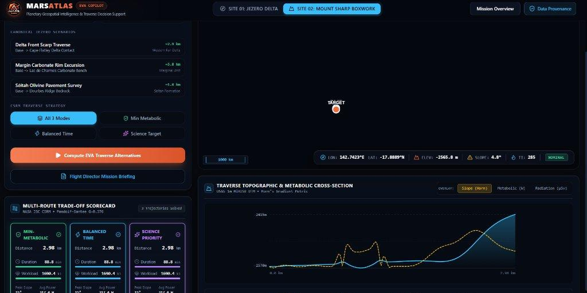
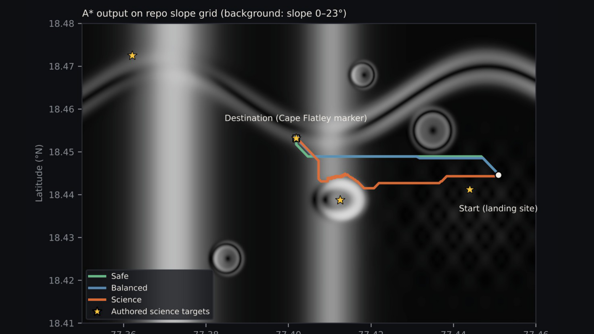
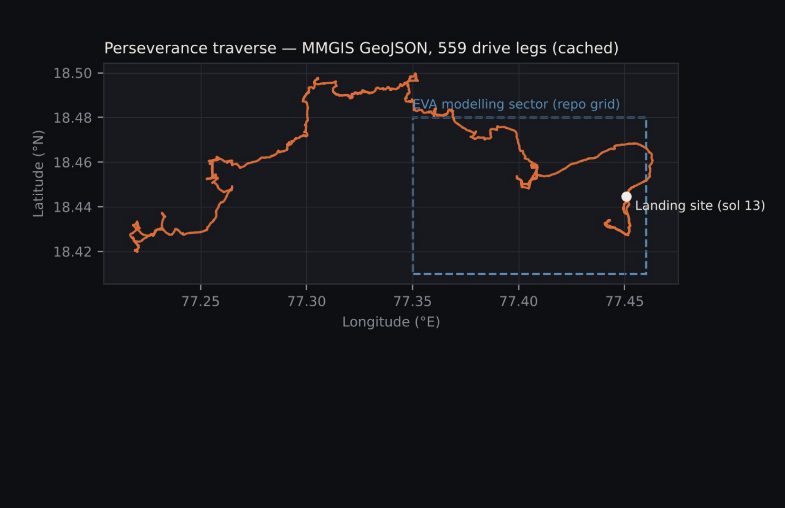
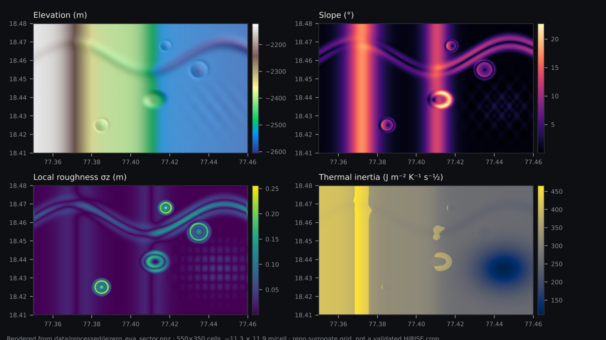
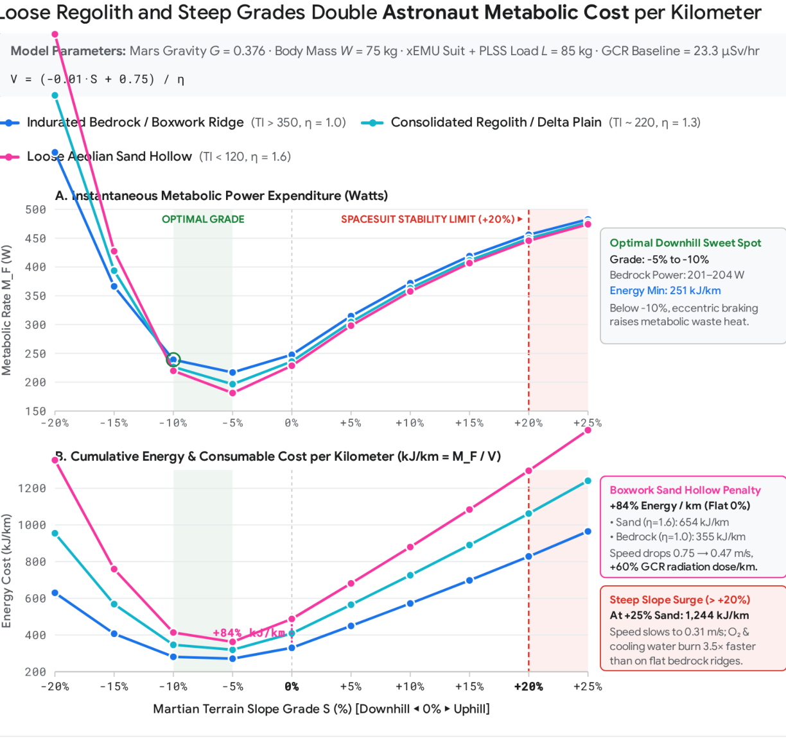

# MarsAtlas: Integrated Martian Terrain Intelligence & EVA Traverse Planning System

> **Explore Mars. Understand Terrain. Plan Every Traverse.**

[](https://www.spaceappschallenge.org/)
[](https://www.spaceappschallenge.org/)
[](#-project-status--disclaimer)
[](LICENSE)
[-10B981.svg)](docs/TESTING.md)

---

## 1. Project Title & Tagline

* **Full Title:** MarsAtlas — Integrated Martian Terrain Intelligence and Extravehicular Activity (EVA) Traverse Planning System
* **Tagline:** *Explore Mars. Understand Terrain. Plan Every Traverse.*
* **Concept:** *From Planetary Data to Exploration Decisions.*
* **Status:** **Experimental Research Prototype** (developed independently for NASA Space Apps Challenge 2026).

---

## 2. Project Summary

**MarsAtlas** is an open-source planetary geospatial decision-support prototype designed to evaluate how future human extravehicular activities (EVAs) on Mars can be planned using multi-mission orbital datasets, terrain analysis, and human bioenergetic models.

Rather than treating the Martian surface as a static, flat 2D map, MarsAtlas models terrain slopes, surface roughness, and thermophysical proxies to evaluate traverse feasibility. The platform integrates real Mars 2020 *Perseverance* rover telemetry from Jezero Crater, visualizes simplified geological units and manually authored CRISM-referenced mineral targets, and computes multi-criteria A* traverse paths that balance slope exposure, transit time, metabolic energy expenditure, and scientific interest.

---

## 3. NASA Space Apps Challenge 2026

* **Hackathon:** [NASA International Space Apps Challenge 2026](https://www.spaceappschallenge.org/)
* **Challenge:** *Interplanetary Survival Guide: Martian Map*
* **Primary Study Region:** Jezero Crater, Mars ($18.44^\circ\text{N}, 77.45^\circ\text{E}$)
* **Comparative Regional Context:** Gale Crater, Mount Sharp Boxwork ($4.75^\circ\text{S}, 137.40^\circ\text{E}$)

---

## 4. Live Application & Repository Links

* **Production Application:** [https://mars-atlas-nasa.vercel.app/](https://mars-atlas-nasa.vercel.app/)
* **Backend API (FastAPI):** [https://marsatlas-backend.onrender.com/](https://marsatlas-backend.onrender.com/)
* **Interactive API Documentation:** [https://marsatlas-backend.onrender.com/docs](https://marsatlas-backend.onrender.com/docs)
* **GitHub Repository:** [https://github.com/shubham25-droid/MarsAtlas](https://github.com/shubham25-droid/MarsAtlas)

---

## 5. Project Visuals & Screenshots


*Figure 1: MarsAtlas interactive planetary mission console showing Jezero Crater Western Fan Delta, Perseverance traverse path, and real-time terrain telemetry.*

| A* Route Planning on Slope Grid | Perseverance In-Situ Traverse Map |
| :---: | :---: |
|  |  |
| *Figure 2: 8-connected A* traverse trajectories (Lower-Slope, Balanced, Science Priority) across modelled slope hazards ($0^\circ - 23^\circ$).* | *Figure 3: Real Perseverance rover traverse (559 drive legs, 708 waypoints, Sols 13–2022) sourced from NASA-AMMOS MMGIS.* |

| Terrain Intelligence Derivatives | Physiological Metabolic Workload Curves |
| :---: | :---: |
|  |  |
| *Figure 4: Modelled terrain derivatives including elevation, Horn's slope, and local roughness.* | *Figure 5: Pandolf-Santee metabolic workload and Apollo velocity degradation curves as a function of surface incline grade.* |

---

## 6. Problem Statement

Long-duration human surface exploration of Mars will present operational challenges distinct from robotic rover operations:
1. **Robotic vs. Human Constraints:** Robotic rovers traverse at centimeters per second over multi-day planning cycles. Human astronauts in pressurized spacesuits face acute physiological ceilings: metabolic heat generation, respiratory exchange limits, steep grade slip hazards, and cumulative ionizing radiation exposure.
2. **Disconnected Orbital Datasets:** High-resolution digital terrain models, thermal inertia maps, spectral mineralogy observations, and rover telemetry are hosted across fragmented planetary science archives, lacking an integrated environment for human traverse planning.
3. **Terrain Risk Blind Spots:** Visual orbital imagery conceals steep incline grades and unconsolidated regolith hazards that can stall or exhaust suited crew members.

---

## 7. Proposed Approach

MarsAtlas addresses these operational needs through a three-layer pipeline:
1. **Planetary Geospatial Foundation:** Interactive 2D planetary mapping in native Mars Equirectangular coordinates (`EPSG:104905`, $R=3,396,190\text{ m}$), co-registering orbital basemaps with real rover telemetry.
2. **Quantitative Terrain Intelligence:** Surface slope evaluated via Horn's $3 \times 3$ finite-difference method on smoothed terrain grids, combined with local elevation roughness and thermophysical proxy coefficients.
3. **Bioenergetically Grounded Traverse Evaluation:** Multi-criteria 8-connected A* pathfinding incorporating spacesuit mass, Martian gravity ($0.376\,g$), Pandolf-Santee bioenergetics, and hard slope ceilings ($\theta \le 22.0^\circ$) to provide actionable route comparisons.

---

## 8. Actual Implemented Capabilities

The repository provides the following verified capabilities:

* **Interactive Planetary GIS:** Web-based mapping powered by OpenLayers 10 in native Mars Equirectangular projection (`EPSG:104905`) with interactive zoom, pan, coordinates readout, and layer management.
* **Perseverance Traverse Overlay:** Display of 708 validated waypoints and 559 traverse legs from NASA-AMMOS MMGIS, spanning Sols 13 through 2022.
* **Point Telemetry Sampling:** Sub-second sampling of elevation, slope, local roughness, thermal inertia proxy, and hazard classification for any coordinate in the modelled sector via `GET /api/point-telemetry`.
* **Multi-Criteria A* Traverse Planner:** Fast graph-search routing evaluating three distinct planning modes (`Lower-Slope Preference`, `Balanced Preference`, `Science Priority`) with an enforced $22.0^\circ$ slope obstacle cutoff via `POST /api/plan-eva`.
* **Synchronized Telemetry Profile:** Elevation, slope grade, metabolic wattage, and ionizing radiation proxy profiles generated along planned traverse paths.
* **3D Sector Mesh Viewer:** Local WebGL 3D terrain surface mesh rendered using Three.js with dynamic solar azimuth lighting.
* **Rover Ground-Truth Photo Proxy:** Spatial query linking map coordinates to nearest Perseverance surface camera observations (Mastcam-Z, SuperCam RMI).
* **Grounded Mission Briefing Generator:** Automated Flight Director summary generating citation-backed route summaries directly from computed metrics via `POST /api/briefing`.

---

## 9. Data Provenance & Implementation Status

To ensure complete scientific transparency, all datasets and features in MarsAtlas are categorized by their actual implementation status:

| Capability / Dataset | Implementation Status | Data Source / Method | Epistemic Classification |
|---|---|---|---|
| **Interactive Planetary Map** | Operational | OpenLayers 10, USGS Viking MDIM2.1 WMS, MOLA Shaded Relief WMS | Measured Orbital Data |
| **Perseverance Waypoints** | Operational | NASA-AMMOS MMGIS (`m20_waypoints.json`, 708 features) | Real Spacecraft Telemetry |
| **Perseverance Traverse Legs** | Operational | NASA-AMMOS MMGIS (`m20_traverse.json`, 559 features) | Real Spacecraft Telemetry |
| **Curiosity Waypoints** | Operational | NASA-AMMOS MMGIS (`msl_waypoints.json`, 1,389 features) | Real Spacecraft Telemetry (Comparative Context) |
| **EVA Terrain Grid** | Operational | `jezero_eva_sector.npz` ($350 \times 550$ cells, $dx \approx 11.3\text{m}, dy \approx 11.9\text{m}$) | **Prototype Surrogate Grid** (Not raw HiRISE crop) |
| **Slope & Roughness Derivatives** | Operational | Horn's $3 \times 3$ finite difference, Gaussian smoothing, local $\sigma_z$ | Derived Computational Estimate |
| **A* Route Comparison** | Operational | 8-connected A* with 3 modes (`Lower-Slope`, `Balanced`, `Science`) | Computational Graph Optimization |
| **Geological Context Units** | Operational | 5 simplified polygon features after Sun & Stack (2020), USGS SIM 3464 | **Manually Authored / Simplified Context** |
| **CRISM Science Targets** | Operational | 5 point targets citing CRISM IDs (`FRT000047A3`, `FRT00005C5E`, etc.) | **Manually Authored Context** (No cube processing) |
| **Rover Ground-Truth Photos** | Operational | NASA Mars 2020 Raw Images API proxy & cached metadata | Real Spacecraft Imagery |
| **Orbital CTX & THEMIS Layers** | Documented | Mars Trek WMTS tile endpoints documented in `DATA_SOURCES.md` | **Documented but Not Integrated in Active Map** |
| **Raw 1m HiRISE DTM GeoTIFF** | Documented | USGS Astrogeology TRN mosaic documented in `DATA_SOURCES.md` | **Documented External Source** (Not parsed live) |
| **Spacesuit Life-Support Engine** | Approximate Model | Pandolf-Santee bioenergetics with suited mass ($W=75\text{kg}, L=85\text{kg}$) | Modeling Assumption (Not certified NASA JSC CSRM) |
| **Surface Radiation Baseline** | Illustrative Proxy | Static MSL RAD surface rate ($23.33\,\mu\text{Sv/hr}$) scaled by time | Surrogate / Illustrative Proxy (Gale RAD transferred) |
| **Astronaut Safety Certification** | **Not Implemented** | None | Excluded from Prototype Scope |

---

## 10. Terrain Intelligence Engine

The MarsAtlas terrain engine processes high-resolution topography over the Jezero EVA sector:
* **Spatial Dimensions:** $350 \text{ rows} \times 550 \text{ columns}$ ($192,500$ cells)
* **Sector Bounding Box:** $77.3500^\circ\text{E} - 77.4600^\circ\text{E}$, $18.4100^\circ\text{N} - 18.4800^\circ\text{N}$
* **Cell Spacing:** $\Delta x \approx 11.27\text{ m}$, $\Delta y \approx 11.89\text{ m}$ (evaluated at $R = 3,396,190\text{ m}$, $\phi \approx 18.45^\circ\text{N}$)
* **Elevation Range:** $-2,604.87\text{ m}$ to $-2,120.65\text{ m}$ relative to MOLA areoid
* **Slope Formulation:** Horn's $3 \times 3$ finite-difference kernel:
  $$\frac{\partial z}{\partial x} = \frac{(c + 2f + i) - (a + 2d + g)}{8 \cdot \Delta x},\quad \frac{\partial z}{\partial y} = \frac{(g + 2h + i) - (a + 2b + c)}{8 \cdot \Delta y}$$
  $$\theta_{\text{deg}} = \arctan\left(\sqrt{\left(\frac{\partial z}{\partial x}\right)^2 + \left(\frac{\partial z}{\partial y}\right)^2}\right) \times \frac{180}{\pi}$$
* **Local Roughness ($\sigma_z$):** Standard deviation of elevation in a local window ($0.000\text{ m}$ to $0.256\text{ m}$). *Note: Roughness represents topographic elevation variation, not soil bearing strength or mechanical traction.*
* **Terrain Impedance ($\eta$):** Dimensionless factor ($1.001$ to $1.593$) derived from thermal inertia and roughness. *Note: Thermal inertia serves as a thermophysical proxy, not a direct measurement of ground firmness.*

### Exploratory Elevation Consistency Check
Comparing 276 real Perseverance rover waypoint elevations against the prototype terrain grid:
* **Root Mean Square Error (RMSE):** $\approx 74\text{ m}$
* **Mean Bias:** $\approx +55\text{ m}$
* **Epistemic Classification:** *Exploratory consistency check only.* This confirms general topographic macro-structure but does **not** constitute independent scientific validation or raw HiRISE DTM fidelity.

---

## 11. A* Route Planning & Bioenergetics

MarsAtlas executes an 8-connected grid search using an admissible Octile distance heuristic.

### Step Cost Formulation
For each directed edge from cell $(r_1, c_1)$ to neighbor $(r_2, c_2)$ with horizontal distance $d$:
$$c = \max\left(0.05,\; w_E \hat{E} + w_T \hat{T} + w_S \left(\frac{\theta}{10}\right)^2 + w_H \max\left(0, \frac{250 - TI}{100}\right) - w_V \min(0.6, V_{\text{sci}})\right) \times \left(\frac{d}{10}\right)$$

Where:
* $\hat{E} = \frac{\Delta E_{\text{kJ}}}{0.35 \cdot d}$ (normalized energy expenditure)
* $\hat{T} = \frac{\Delta t}{d / 0.70}$ (normalized transit time)
* $\theta$ = local slope gradient in degrees
* $TI$ = local thermal inertia value
* $V_{\text{sci}}$ = Gaussian proximity bonus from manually authored CRISM targets
* **Hard Obstacle Threshold:** Cells with local slope $\theta > 22.0^\circ$ are rejected as impassable obstacles. This is an engineering constraint for suited stability, not a certified universal safety boundary.

### Planning Configurations
The planner provides three configurable modes:
1. **Lower-Slope Preference (`safe`):** $w_E = 2.5, w_T = 0.2, w_S = 8.0, w_H = 5.0, w_V = 0.0$. Heavily penalizes steep grades and soft regolith proxies to minimize metabolic fatigue.
2. **Balanced Preference (`balanced`):** $w_E = 0.4, w_T = 3.0, w_S = 1.5, w_H = 1.0, w_V = 0.0$. Optimized for transit efficiency, balancing distance against moderate inclines.
3. **Science Priority (`science`):** $w_E = 0.8, w_T = 0.5, w_S = 1.2, w_H = 1.0, w_V = 8.0$. Diverts the route within a 25-cell Gaussian window toward high-value scientific targets.

### Physiological Assumptions
* Suited Astronaut: Nude mass $W = 75.0\text{ kg}$, Pressurized suit + PLSS $L = 85.0\text{ kg}$ (Total system mass $= 160.0\text{ kg}$).
* Gravity: Mars gravity $g_{\text{Mars}} = 0.376 \cdot g_{\text{Earth}}$.
* Walking Speed: Dynamic Apollo degradation $V = \max\left(0.15, \frac{-0.01 S + 0.75}{\eta}\right)\text{ m/s}$ where $S$ is directional grade percentage.
* Metabolic Expenditure: Evaluated via Pandolf-Santee formulation with downhill eccentric braking recovery ($M_F \ge 120\text{ W}$). *This model approximates suited walking bioenergetics and does not simulate full NASA JSC CSRM life-support subsystems (such as oxygen consumption or thermal loop rejection).*

---

## 12. Actual Technology Stack

* **Frontend:**
  * **Framework:** Next.js 16.4.6 (App Router)
  * **UI Library:** React 19.3.0
  * **Language:** TypeScript 5
  * **Styling:** Tailwind CSS 4.3.3
  * **Planetary Mapping:** OpenLayers 10.11.0 (Native `EPSG:104905`)
  * **3D Visualization:** Three.js 0.187.0 (WebGL terrain mesh)
  * **Icons:** Lucide React 1.72.0
* **Backend:**
  * **API Framework:** FastAPI 0.110.0+ / Starlette 0.36.0+
  * **ASGI Server:** Uvicorn 0.28.0+
  * **Runtime:** Python 3.12
  * **Scientific Computing:** NumPy 2.0.0+, SciPy 1.14.0+
  * **Geospatial & Image I/O:** Pillow 10.0.0+, Tifffile 2024.0.0+
  * **Validation & Testing:** Pydantic 2.7.0+, Pytest 8.0.0+, HTTPX 0.27.0+
* **Deployment & Hosting:**
  * **Frontend:** Vercel
  * **Backend:** Render (Python Web Service via `render.yaml`)

---

## 13. System Architecture

```text
       AVAILABLE PLANETARY & ROVER DATASETS
(NASA-AMMOS MMGIS GeoJSON, USGS SIM 3464, CRISM Targets, MSL RAD Proxy)
                         │
                         ▼
             DATA PREPROCESSING & CACHING
  (Mars Radii EPSG:104905, Prototype Grid jezero_eva_sector.npz)
                         │
                         ▼
              TERRAIN INTELLIGENCE ENGINE
  (Elevation z, Horn 3x3 Slope θ, Roughness σz, Terrain Factor η)
                         │
                         ▼
             A* MULTI-CRITERIA PATHFINDER
 (Lower-Slope / Balanced / Science Modes, Pandolf Bioenergetics, 22° Cutoff)
                         │
                         ▼
                 FASTAPI BACKEND
  (REST Endpoints: /health, /point-telemetry, /plan-eva, /briefing, /rover-pov)
                         │
                         │ HTTP / JSON
                         ▼
             NEXT.JS + OPENLAYERS CLIENT
  (EPSG:104905 Map, 3D Three.js Mesh, Telemetry HUD, Flight Director Briefing)
```

---

## 14. Project Structure

```text
MarsAtlas/
├── backend/
│   ├── app/
│   │   ├── api/
│   │   │   └── routes.py             # 6 REST endpoints (/health, /point-telemetry, /plan-eva, etc.)
│   │   ├── terrain/
│   │   │   └── engine.py             # DTM sampling, bounds check, hazard classification
│   │   ├── routing/
│   │   │   └── planner.py            # 8-connected A* graph search & Pandolf bioenergetics
│   │   ├── services/
│   │   │   └── rover_pov.py          # Geolocated rover image proxy & metadata cache
│   │   └── main.py                   # FastAPI application initialization & HTML root
│   ├── tests/
│   │   └── test_geospatial_engine.py # Pytest validation suite (8 tests)
│   ├── requirements.txt              # Pinned Python dependencies
│   └── .env.example                  # Backend environment template
├── frontend/
│   ├── src/
│   │   ├── app/                      # Next.js App Router (layout, page, globals.css)
│   │   ├── components/
│   │   │   ├── landing/              # Hero banner, mission badges, telemetry cards
│   │   │   ├── map/                  # OpenLayers EPSG:104905 & Three.js 3D modal
│   │   │   ├── mission/              # Route Planner panel, scorecard, profile chart
│   │   │   ├── science/              # CRISM hotspots & rover POV inspector
│   │   │   ├── dashboard/            # Mission briefing modal & environmental HUD
│   │   │   └── shared/               # Navigation header & data provenance modal
│   │   ├── services/                 # API client with offline fallback cache
│   │   └── types/                    # TypeScript interfaces
│   ├── public/                       # Logos, icons, branding, pre-cached GeoJSONs
│   ├── package.json                  # Next.js 16 & React 19 dependencies
│   └── .env.example                  # Frontend environment template
├── data/
│   ├── raw/                          # Placeholder for raw orbital rasters (.gitkeep)
│   └── processed/                    # jezero_eva_sector.npz, rover & geology GeoJSONs
├── docs/
│   ├── ARCHITECTURE.md               # Corrected system architecture document
│   ├── DATA_SOURCES.md               # Four-part transparent data provenance catalog
│   ├── SCIENTIFIC_ASSUMPTIONS.md     # Mathematical formulations & known limitations
│   ├── API.md                        # Complete FastAPI endpoint documentation
│   ├── TESTING.md                    # Test execution guide & verification limits
│   ├── DEPLOYMENT.md                 # Vercel & Render cloud deployment guide
│   ├── REPOSITORY_AUDIT.md           # Submission audit, claim verification, risk report
│   └── WEBSITE_AUDIT.md              # Frontend UI/UX, mobile responsiveness & API audit
├── .env.example                      # Root environment configuration template
├── .gitignore                        # Git exclusion rules (secrets, node_modules, cache)
├── render.yaml                       # Render web service configuration
├── CONTRIBUTING.md                   # Contribution workflow & epistemic tier rules
├── LICENSE                           # MIT License
└── README.md                         # Project documentation
```

---

## 15. Installation & Local Setup

### Prerequisites
* **Node.js:** v18.17+ or v20+
* **npm:** v9+
* **Python:** 3.12 (recommended) or 3.10+
* **Git:** Latest release

### Clone Repository
```bash
git clone https://github.com/shubham25-droid/MarsAtlas.git
cd MarsAtlas
```

---

## 16. Backend & Frontend Startup Instructions

### 1. Backend Setup (FastAPI)
```bash
cd backend
python -m venv .venv
# On Windows:
.venv\Scripts\activate
# On Linux/macOS:
# source .venv/bin/activate

python -m pip install --upgrade pip
python -m pip install -r requirements.txt

# Start backend server
python -m uvicorn app.main:app --host 127.0.0.1 --port 8000 --reload
```
* Backend Root: [http://127.0.0.1:8000/](http://127.0.0.1:8000/)
* Interactive Swagger Docs: [http://127.0.0.1:8000/docs](http://127.0.0.1:8000/docs)

### 2. Frontend Setup (Next.js)
Open a new terminal window:
```bash
cd frontend
npm install

# Start development server
npm run dev
```
* Open [http://localhost:3000](http://localhost:3000) in your browser.

---

## 17. Test Instructions & Verified Results

MarsAtlas includes an automated test suite verifying geodetic constants, terrain loading, telemetry sampling, Horn's slope formula, A* pathfinding convergence, rover lookup, and FastAPI endpoint contracts.

### Execute Backend Test Suite
```bash
python -m pytest backend/tests/test_geospatial_engine.py -v
```

### Verified Test Results
```text
============================= test session starts =============================
platform win32 -- Python 3.12.7, pytest-9.1.1
rootdir: D:\Antigravity Workspace\NASA Space Challenge 2026\MarsAtlas
collected 8 items

backend/tests/test_geospatial_engine.py::test_geodetic_constants PASSED         [ 12%]
backend/tests/test_geospatial_engine.py::test_terrain_engine_loading PASSED     [ 25%]
backend/tests/test_geospatial_engine.py::test_point_telemetry_sampling PASSED   [ 37%]
backend/tests/test_geospatial_engine.py::test_out_of_bounds_rejection PASSED    [ 50%]
backend/tests/test_geospatial_engine.py::test_horns_slope_formulation PASSED    [ 62%]
backend/tests/test_geospatial_engine.py::test_eva_pathfinder_convergence PASSED [ 75%]
backend/tests/test_geospatial_engine.py::test_nearest_rover_observation PASSED [ 87%]
backend/tests/test_geospatial_engine.py::test_fastapi_endpoints PASSED          [100%]

======================== 8 passed, 1 warning in 10.70s ========================
```
*Note: A Starlette deprecation warning regarding HTTPX test client is benign and does not affect test execution. For details on what these tests verify vs. what remains unvalidated, see [docs/TESTING.md](docs/TESTING.md).*

---

## 18. Deployment Information

* **Frontend:** Deployed on **Vercel** with automatic branch deployments from GitHub.
  * Live URL: [https://mars-atlas-nasa.vercel.app/](https://mars-atlas-nasa.vercel.app/)
* **Backend:** Deployed on **Render** as a Python 3.12 Web Service using [`render.yaml`](render.yaml).
  * API Base: [https://marsatlas-backend.onrender.com/](https://marsatlas-backend.onrender.com/)
  * *Note: Render free-tier instances spin down during periods of inactivity; the initial request may experience a 30–60 second cold-start delay.*
* Complete deployment procedures and environment configurations are documented in [docs/DEPLOYMENT.md](docs/DEPLOYMENT.md).

---

## 19. Scientific Limitations & Epistemic Boundaries

To maintain scientific integrity, the limitations of this prototype must be explicitly noted:

1. **Prototype Surrogate Terrain Grid:** The active terrain file `jezero_eva_sector.npz` is a prototype surrogate grid ($350 \times 550$ cells), **not** a validated crop directly derived from the raw 1-meter HiRISE DTM.
2. **Exploratory Consistency Check:** The reported elevation comparison with 276 Perseverance waypoints ($\text{RMSE} \approx 74\text{ m}$, $\text{bias} \approx +55\text{ m}$) represents an exploratory consistency check, not independent scientific validation.
3. **No Spectral Cube Processing:** The 5 CRISM targets are manually authored coordinates referencing published CRISM observation IDs. MarsAtlas does not perform raw hyperspectral cube processing or automated mineral identification.
4. **Approximate Geological Overlays:** The 5 geological polygon formations are hand-simplified representations based on USGS SIM 3464, not a complete vector GIS map.
5. **Simplified Bioenergetics:** The Pandolf-Santee bioenergetic equations provide an illustrative estimation of suited walking workload. They do not model full spacesuit life-support systems (PLSS oxygen draw, trace contaminant accumulation, or liquid cooling garment loops).
6. **Radiation Proxy:** Radiation dosage values represent an illustrative scaling from the MSL RAD Gale Crater surface baseline ($23.33\,\mu\text{Sv/hr}$), not an in-situ Jezero measurement.
7. **Implementation Slope Cutoff:** The $22.0^\circ$ slope exclusion ceiling is an algorithmic heuristic for suited stability, not an authoritative NASA EVA flight rule.

---

## 20. AI Tool Disclosure

In accordance with NASA Space Apps Challenge guidelines:
* **AI Assistance:** AI development tools (including ChatGPT, Gemini, Claude, and Google Antigravity) were utilized during the development of MarsAtlas to assist with software engineering, refactoring, code structuring, documentation auditing, and graphic design assistance.
* **Human Oversight:** All architectural decisions, mathematical formulas, data integration workflows, scientific disclosures, and source verifications were audited, reviewed, and finalized by the project author. AI tools were not used to generate fabricated scientific measurements or to claim unverified discoveries.
* **Visual Assets:** Submissions and presentation decks adhere to challenge disclosure rules regarding generated visual elements.

---

## 21. Data Attribution & Licensing

* **Software License:** MarsAtlas source code is released under the [MIT License](LICENSE).
* **Dataset Attribution:**
  * **Perseverance & Curiosity Telemetry:** NASA / JPL-Caltech / NASA-AMMOS MMGIS.
  * **Topography & Cartography References:** USGS Astrogeology Science Center / NASA Mars Trek.
  * **Geological Mapping:** USGS Scientific Investigations Map 3464 (Sun & Stack, 2020).
  * **CRISM Spectral Data References:** NASA / JPL / JHUAPL / PDS Geosciences Node.
  * **Surface Weather & Radiation Baselines:** Mars 2020 MEDA team / MSL RAD team / PDS Atmospheres Node.
* Third-party orbital datasets and imagery remain subject to their respective NASA, USGS, and PDS public-domain policies and citation requirements. The MIT software license applies strictly to the MarsAtlas software codebase.

---

## 22. Independent Development & NASA Non-Endorsement Disclaimer

> **DISCLAIMER:** MarsAtlas is an independent experimental research prototype created for the **NASA International Space Apps Challenge 2026**. It is **not** an official NASA product, operational mission-planning platform, or certified astronaut safety system. Mention of NASA, JPL, USGS, or specific mission names does not imply endorsement, sponsorship, or operational certification by the United States Government or any space agency.
