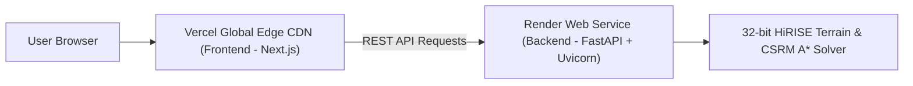

# 🚀 MarsAtlas Deployment Guide (Render + Vercel)

This guide provides step-by-step instructions to deploy **MarsAtlas** to production for free using:
- **Backend (Python FastAPI)**: Hosted on [Render](https://render.com)
- **Frontend (Next.js 16 + OpenLayers)**: Hosted on [Vercel](https://vercel.com)

---

## 🛰️ Architecture Overview

---

## Part 1: Deploy Backend on Render (FastAPI)

Render provides free hosting for Python web services.

### Option A: Using Render Blueprint (Recommended - 1 Click)
1. Go to [render.com](https://render.com) and log in with GitHub.
2. Click **New +** → **Blueprint**.
3. Select your repository: `shubham25-droid/MarsAtlas`.
4. Render will automatically detect [`render.yaml`](../render.yaml) and configure the web service:
   - **Runtime**: Python 3.12
   - **Root Directory**: `backend`
   - **Build Command**: `pip install -r requirements.txt`
   - **Start Command**: `uvicorn app.main:app --host 0.0.0.0 --port $PORT`
5. Click **Apply**.
6. Once deployed, copy your backend URL (e.g. `https://marsatlas-backend.onrender.com`).
7. Test the health endpoint: `https://marsatlas-backend.onrender.com/api/health`.

### Option B: Manual Web Service Setup
1. On Render Dashboard, click **New +** → **Web Service**.
2. Connect `shubham25-droid/MarsAtlas`.
3. Set the following fields:
   - **Name**: `marsatlas-backend`
   - **Region**: Oregon (US West) or Frankfurt (EU)
   - **Root Directory**: `backend`
   - **Runtime**: `Python 3`
   - **Build Command**: `pip install -r requirements.txt`
   - **Start Command**: `uvicorn app.main:app --host 0.0.0.0 --port $PORT`
   - **Instance Type**: Free
4. Click **Create Web Service**.

---

## Part 2: Deploy Frontend on Vercel (Next.js)

Vercel is built specifically for Next.js and deploys in under 2 minutes.

1. Go to [vercel.com](https://vercel.com) and sign in with your GitHub account.
2. Click **Add New...** → **Project**.
3. Select `MarsAtlas` from your GitHub repositories and click **Import**.
4. In the **Configure Project** screen:
   - **Framework Preset**: `Next.js` (auto-detected)
   - **Root Directory**: Click *Edit* and select **`frontend`** (Important!)
5. Expand **Environment Variables** and add:
   - **Key**: `NEXT_PUBLIC_BACKEND_URL`
   - **Value**: Your Render backend URL (e.g., `https://marsatlas-backend.onrender.com` without trailing slash)
6. Click **Deploy**.
7. Vercel will build and assign you a free production domain, e.g.:
   `https://marsatlas.vercel.app`

---

## Part 3: Verification Checklist

| Step | Action | Expected Output |
| :--- | :--- | :--- |
| 1 | Visit `https://your-backend.onrender.com/api/health` | `{"status": "ONLINE", "challenge": "NASA Space Apps Challenge 2026", ...}` |
| 2 | Open your Vercel URL `https://your-app.vercel.app` | MarsAtlas landing page with mission emblem and telemetry banner |
| 3 | Click **Launch Mission Console** | OpenLayers equirectangular projection loads Jezero Crater |
| 4 | Click **Compute Optimized Traverse** | Multi-route trade-off scorecard and SVG elevation profile render instantly |
| 5 | Inspect Network Tab | Requests to `POST /api/plan-eva` return HTTP 200 OK |

> [!NOTE]
> On Render's free tier, the backend spins down after 15 minutes of inactivity. When a new request arrives, it may take 20–30 seconds to spin back up. MarsAtlas includes an automatic, high-precision client-side route fallback so the frontend never crashes while the backend wakes up.
